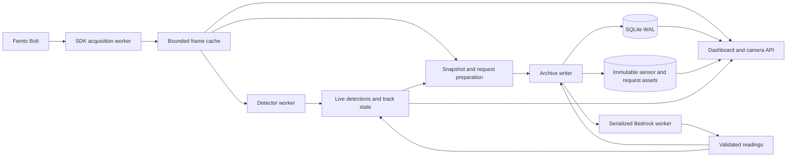

# Local Femto Bolt and Bedrock: feature definition and verifiable design

Revision 2 · October 26, 2026 · implementation specification.

The user selected Nova 2 Lite as the initial model and authorized falling back
to Nova Lite if latency becomes a problem. This document defines the requested
local application through observable behavior and acceptance checks. The
implementation and qualification limits are recorded in the verification ledger.
A requirement below is not by itself a claim that its complete acceptance
procedure has been performed.

**Release outcome:** one local Python application owns the Femto Bolt, exposes
color/depth/IR through an unauthenticated camera API, runs object detection and
Bedrock analysis, and preserves the evidence and review history locally.

## 1. Decisions and evidence

| Decision | Definition | Basis |
| --- | --- | --- |
| Runtime | One application process and one HTTP listener; singleton camera ownership | User requested a local singleton runner |
| Storage | SQLite WAL plus content-addressed assets | Proposed local architecture; removes the separate archive service dependency |
| Capture | Orbbec SDK for Femto Bolt; V4L2 remains available for ordinary color cameras | All three Bolt streams were captured successfully |
| Primary VLM | `us.amazon.nova-2-lite-v1:0`, reasoning disabled | User selected Nova 2 Lite after actual-image latency checks |
| Latency fallback | `us.amazon.nova-lite-v1:0`, selected explicitly | User authorized fallback if latency is troublesome |
| AWS | Profile `default`, source region `us-west-2` | User selected this profile; real calls succeeded |
| Initial detector | Existing pinned YOLOE ONNX artifact on CPU | Reuses the existing detector and vocabulary |
| Camera access | No camera login; localhost by default, configurable bind address | User requested direct API access without camera access restrictions |
| GPU | Optional inference backend with separate qualification | User offered a desktop GPU; target GPU host remains unidentified |

The October 26 preflight verified complete frame sets with color at 1280 × 720
MJPEG and depth/IR at 640 × 576 uint16, configured at 15 FPS. SDK registration
produced depth at the color resolution. Sampled depth/IR timestamps matched;
color differed by approximately 1 ms. The SDK reported 1 mm per depth unit.
These checks do not establish sustained capture performance or physical depth
accuracy.

| Model | Color median, 5 calls | Color + depth + IR median, 3 calls | JSON validation |
| --- | --- | --- | --- |
| Nova Lite v1 | 0.771 s | 1.015 s | 8/8 |
| Nova 2 Lite | 0.882 s | 1.346 s | 8/8 |
| Haiku 4.5 | 1.236 s | 1.410 s | 8/8 |

The comparison used one real Bolt scene, 640-pixel-wide JPEGs, and short JSON
answers. Its timers included the client Converse call, excluding capture,
preprocessing, and persistence. It did not test the full per-crop application
schema or score answer correctness. One Hz is an observed reference point,
not a feature constraint, rate ceiling, or throughput promise.

See [benchmark and lifecycle evidence](bedrock-image-benchmark.md). All three
models were Active in the regional API at the time of that check. Lifecycle
must be checked again when implementing or changing the deployment.

The current host reports Intel Iris Xe graphics and no `nvidia-smi` executable.
A single CPU detector inference took 77 ms; this is not a pipeline benchmark.
The unmodified repository's 66 Python tests passed in the prepared environment.

## 2. Release boundary

Release 1 includes singleton lifecycle, synchronized capture, direct camera
API access, registered depth summaries, local persistence, the existing review
features, Nova 2 Lite, and operator-selected Nova Lite fallback.

Optional work includes GPU inference, instance masks, and a model
that consumes RGB and depth directly. These have separate acceptance checks
and do not gate Release 1. Automatic model switching is deferred; the initial
fallback is an explicit operator action with an audit record.

Revision 2 includes the requested live 3D point-cloud viewer and automatic
capture controls. It changes new automatic observation sampling to one shared,
saved 60-second interval rather than separately archiving every live VLM job.

The existing board/Kubernetes deployment remains a separate execution path.
Local data uses its own state directory. Migration of existing remote archives,
changes to the home deployment, and public hosting are outside this release.

## 3. Architecture and lifecycle



These are threads/components within one application. Camera reads occur only
in acquisition. HTTP handlers, detection, persistence, and VLM work consume
owned snapshots. SDK-owned buffers are copied or retained through an explicit
ownership mechanism before another thread uses them.

The frame cache is bounded by both frame count and bytes. Detector and live
analysis each retain at most one pending candidate. Slow consumers replace
that pending candidate with newer input; an in-flight operation is not
reassigned to another frame.

Startup validates configuration, acquires the lock, initializes storage and
the listener, then starts acquisition and inference workers. Camera or model
unavailability is reported through status while archive browsing stays
available. Invalid configuration or an unusable state database fails startup
with a concrete error. SDK/model acquisition never triggers an implicit model
or firmware download.

| ID | Verifiable requirement | Check |
| --- | --- | --- |
| RUN-01 | One entry point starts the application without Kubernetes, Redis, or Docker. | V01 |
| RUN-02 | A second runner using the same camera identity is rejected before starting sensor acquisition, including when a different state directory is used. | V01 |
| RUN-03 | All camera API consumers share one acquisition owner. | V01, V05 |
| RUN-04 | Blocking inference or an unavailable Bedrock endpoint does not stop raw frame acquisition and camera reads. | V10, V11 |
| RUN-05 | Status exposes separate capture, detector, storage, and VLM states and concrete failure categories. | V06, V10, V14 |
| RUN-06 | Shutdown closes the listener, releases the camera and lock, and drains already accepted writes within the configured shutdown deadline; a forced exit leaves recoverable job state. | V01, V07 |

The lock is keyed by stable physical camera identity, preferring USB serial,
and held for the process lifetime in a common per-user runtime location.
Device aliases and backend choices must normalize to the same identity.
Discovery can precede the lock; sensor acquisition cannot. File existence
alone is not the lock. SDK serial selection is mandatory when multiple
eligible Bolts are attached. Cross-user exclusivity also depends on device
permissions and SDK behavior; Release 1 tests same-user runners.

## 4. Configuration contract

The following are proposed Release 1 defaults, not additional measured facts.
They are recorded in the effective configuration at startup and with each
relevant observation or attempt.

| Setting | Initial value | Meaning |
| --- | --- | --- |
| State directory | `~/.local/share/bolt-rgb` | SQLite, assets, and local application state |
| HTTP bind / port | `127.0.0.1` / `8080` | One dashboard/API listener |
| Camera backend | `orbbec` | Femto Bolt color, depth, and IR |
| Serial | Discovered if exactly one Bolt exists | Stable device selection |
| Color profile | 1280 × 720 MJPEG, 15 FPS | Validated against advertised SDK profiles |
| Depth / IR profiles | 640 × 576 Y16, 15 FPS | Matching native modes |
| Maximum channel timestamp skew | 10 ms | Proposed acceptance tolerance for a complete frame set |
| Frame freshness | 2 s | Maximum host-receipt age for a fresh camera read |
| Frame cache | 8 frame sets; 128 MiB | Evict oldest sets until both bounds are satisfied |
| Detector cadence | 5 FPS target | Configurable worker sampling; no capture rate coupling |
| Detector / VLM display thresholds | 0.45 / 0.65 | Preserve the current confidence defaults |
| Display mode / VLM pause | Objects / running | Saved revisions override these new-state defaults |
| Live VLM minimum dispatch interval | 0 s | Capacity-driven by default; configurable intentional spacing |
| VLM concurrency / pending live inputs | 1 / 1 | One in flight and the newest pending candidate |
| Automatic observation interval | 60 s | One shared sampler supplies archive observations and live VLM inputs; saved and editable |
| Capture pause | Running | Saved pause stops automatic observations/live jobs; previews and explicit one-shot capture remain available |
| 3D viewer | RGB-D point cloud, up to 4 Hz | Registered calibrated points, at most 30,000 per response; RGB or depth shading |
| AWS profile / source region | `default` / `us-west-2` | SDK credential chain for the selected profile |
| Default selected model | `us.amazon.nova-2-lite-v1:0` | Applied to a new state directory |
| Fallback model | `us.amazon.nova-lite-v1:0` | Explicit latency fallback |
| Nova 2 reasoning | Disabled | Same setting as the latency preflight |
| Request channels | Color, depth preview, IR preview | Actual images plus registered depth summaries |
| Scene/auxiliary preview width | At most 640 pixels | Preserve aspect ratio |
| Crop longest side | At most 384 pixels | Preserve aspect ratio; retain original crop coordinates |
| Crops per VLM batch | At most 4 | One scene image, numbered crops, and available auxiliary previews |
| Response token limit | 1600 | Full box/material schema; deliberately larger than the preflight |
| Bedrock timeouts | 5 s connect; 15 s read | Proposed bounds; measured and configurable |
| Automatic request retries | 0 | Fail explicitly; manual reanalysis is available |
| Failure backoff | 1, 2, 4, ... up to 30 s | Delay future automatic jobs after cloud failure; reset on success |
| Reconnect backoff | 1, 2, 4, ... up to 30 s | Bound camera reconnect attempts; reset on complete capture |
| Pending manual jobs | At most 100 | Durable queue; return a capacity error when full |
| Pending archive mutations | At most 16 | Backpressure is explicit; camera consumers do not wait for this queue |
| Minimum valid depth samples | 30 | Below this count, quantiles are null with an insufficiency reason |
| Live reading maximum age | 30 s | Expired readings leave the detector as display provider |
| MJPEG viewers | At most 8 across channels | Resource limit; no authentication requirement |
| Concurrent exports | 1 | Separate from camera viewer admission |
| Shutdown drain deadline | 10 s | Bound process shutdown while keeping persisted recovery state |

CLI overrides application environment settings; both override persisted
runtime settings when explicitly supplied. Otherwise, a saved model selection,
threshold, display mode, or pause setting survives restart. Built-in defaults
apply only when no explicit or saved value exists. Startup must not reset a
saved fallback selection merely because the CLI has a default value.

The basic command is:

```sh
python -m rgb.local --profile default --region us-west-2
```

An explicit `--model us.amazon.nova-2-lite-v1:0` overrides a saved model
selection and records a new policy revision. Exact CLI spelling for the other
settings is part of implementation; their semantics above are the contract.

## 5. Frame and calibration contract

A `FrameSet` has a schema version, globally unique frame ID, capture-session
ID, source ID, sequence, host receipt time in UTC, host monotonic receipt time,
device identity, requested and actual stream profiles, per-channel SDK
timestamps with their reported domain, channel availability, synchronization
state, depth scale, and calibration ID.

Arrays include color RGB uint8, native depth uint16, native IR uint16, and
registered depth uint16. Registration targets color. Metadata identifies the
coordinate system of every channel. Native IR is not assumed registered.
Unknown timestamp domains are marked unknown; an SDK timestamp is not silently
interpreted as a UTC epoch. Observations use host receipt UTC as their reported
observation time, with that time basis recorded.

The calibration object records native and target intrinsics, distortion,
extrinsics, units and coordinate conventions, SDK/firmware versions, and the
actual stream profiles. Its ID is the SHA-256 of canonical serialized content.
Calibration is reassessed after reconnect or a profile change. Data refers to
the calibration revision used for that frame.

Canonical JSON uses UTF-8, sorted keys, compact separators, and no nonfinite
numbers. The exact calibration bytes are retained as an asset; readers verify
those bytes rather than attempting to recreate the serialization.

The bundle array names and types are part of the API contract:

| Array | Type and shape | Coordinate system |
| --- | --- | --- |
| `color_rgb` | uint8 `[color_height, color_width, 3]` | Color, RGB channel order |
| `depth_native` | uint16 `[depth_height, depth_width]` | Native depth |
| `ir_native` | uint16 `[ir_height, ir_width]` | Native IR |
| `depth_registered` | uint16 `[color_height, color_width]` | Color |
| `metadata_json_utf8` | uint8 `[encoded_metadata_bytes]` | UTF-8 metadata, including calibration |

Unavailable optional channels in an explicitly configured color-only backend
are absent arrays with explicit availability metadata. They are not empty
arrays pretending to be captured sensor data.

| ID | Verifiable requirement | Check |
| --- | --- | --- |
| CAP-01 | The Bolt backend enables the selected color, depth, and IR modes together and reports their actual dimensions, formats, and rates. | V02 |
| CAP-02 | Every published frame has immutable identity, session, source, timestamps, profiles, scale, and channel metadata. | V02, V05 |
| CAP-03 | Native depth/IR retain uint16 values; preview normalization cannot modify raw arrays or stored raw evidence. | V02, V04 |
| CAP-04 | Registered depth uses the SDK's calibration and has the color image's dimensions and declared coordinate system. | V03 |
| CAP-05 | A set is marked synchronized only when required channels exist and measured timestamp skew is within the configured tolerance; unsynchronized sets cannot supply accepted object depth summaries. | V02, V06 |
| CAP-06 | Reconnect creates a new capture session, reloads calibration, and invalidates earlier live track associations. | V06, V19 |
| CAP-07 | Missing or stale required channels are visible as unavailable; stale images are not returned as fresh images. | V06 |
| CAP-08 | V4L2 mode advertises color-only capability explicitly, with no invented depth, IR, or calibration. | V06 |

A normal Bolt frame cache entry requires a complete configured set. Rejected
or incomplete inputs increment diagnostic counters and retain their rejection
reason; they do not replace the last complete entry. The last complete entry
expires according to freshness. A missing stream therefore becomes a visible
camera degradation rather than an indefinite display of old sensor data.

## 6. Depth measurement contract

Detection boxes retain normalized `[ymin, xmin, ymax, xmax]` coordinates in
color space. The initial measurement basis is the clipped bounding-box ROI
in registered depth. A future instance mask is a different recorded basis.
Use the existing `common.geometry.bounds` convention: floor the minimum
coordinates, ceil the maximum coordinates, clip to image bounds, and treat
the maximum pixel bounds as exclusive.

Convert valid depth to meters with `raw * depth_scale_mm / 1000`. Count all ROI
pixels in the coverage denominator. Raw zero and explicitly invalid samples
are excluded from quantiles. Return `sample_count`, `valid_fraction`, median,
10th/90th percentiles, units, measurement basis, frame ID, and calibration ID.
Depth percentiles use linear interpolation on the sorted valid samples.
With fewer than the configured minimum valid samples, quantiles are null and
status is `insufficient_depth`; coverage and counts remain available.

A box ROI can include background. The UI calls this a region depth summary,
not exact object distance or dimensions. Temperature, full object volume,
recyclability, and verified material composition are not inferred from these
measurements.

| ID | Verifiable requirement | Check |
| --- | --- | --- |
| GEO-01 | Unit conversion and ROI coordinates agree with deterministic depth fixtures and the declared scale. | V04 |
| GEO-02 | Invalid/zero depth never becomes a zero-meter measurement; empty or insufficient ROIs return explicit null results. | V04 |
| GEO-03 | Counts, coverage, quantiles, measurement basis, and calibration references accompany every depth summary. | V04, V05 |
| GEO-04 | Measured region depth, detector confidence, VLM confidence, and IR intensity are distinct typed fields and distinct UI labels. | V04, V20 |

## 7. Camera API contract

The dashboard and camera routes share one listener and frame cache. Camera
reads require no credential. Browsing raw frames does not submit Bedrock work.
All responses use `Cache-Control: no-store`.

A frame ID can be supplied through `?frame_id=...` to a snapshot, raw-image,
calibration, bundle, or detection request. An ID with no retained frame returns
410; a malformed ID returns 400. A request without an ID selects a fresh
latest frame. Unsupported channel names return 404. A supported channel with
no fresh data returns 503 with a machine-readable reason.

| Endpoint | Result |
| --- | --- |
| `GET /healthz` | Process/storage health; model or camera degradation is reported separately |
| `GET /api/camera/status` | Always-readable component states, device/modes, latest frame/session ID, freshness, counters, errors |
| `GET /api/camera/calibration` | Calibration and units for the requested or latest fresh frame |
| `GET /api/camera/{color,depth,ir}/stream` | Shared MJPEG display preview |
| `GET /api/camera/{color,depth,ir}/snapshot.jpg` | Display snapshot; depth/IR include normalization metadata |
| `GET /api/camera/{depth,ir}/raw.png` | Lossless native uint16 PNG; depth scale and coordinate system in accompanying metadata |
| `GET /api/camera/frame` | One coherent NPZ bundle with all available raw channels, registered depth, and metadata |
| `GET /api/camera/pointcloud` | Bounded float32 XYZ/RGB binary frame in color-camera coordinates and metres; no archive mutation |
| `GET /api/camera/detections` | Latest completed detector result, its own input frame ID/time, boxes, tracks, depth, and any accepted live reading |
| `POST /api/camera/observations` | Persist a chosen retained frame and its matching detections without invoking the VLM; return observation ID |

Image responses identify frame, session, channel, host time, and calibration
through `X-RGB-*` headers. Depth additionally identifies scale and coordinates.
JSON status describes the complete normalization metadata. MJPEG parts carry
frame IDs and timestamps. Unpinned reads require a fresh latest frame.
A pinned immutable frame remains readable until cache eviction, even if its
age exceeds the freshness window; longer-term historical retrieval uses
the archive.

The NPZ bundle contains named numerical arrays and UTF-8 JSON metadata encoded
as a uint8 array. It must load with `numpy.load(..., allow_pickle=False)`.
Separate latest-channel requests can select different frames; clients needing
coherent inputs use a retained frame ID or the atomic bundle.

The depth preview uses a recorded 0–5 m color legend, black for invalid samples,
and declared clipping above the preview range. IR uses grayscale with recorded
per-frame 1st/99th percentile contrast bounds. Constant-intensity fixtures must
remain well defined. Both transforms leave raw values intact.

Native raw depth/IR use their native profiles. Registered depth is available
in the bundle and archive; its display preview uses the color coordinate
system. IR display remains native unless a future explicitly named projection
is implemented.

The detection endpoint reports its detector input frame ID rather than
pretending that inference has completed on the newest camera frame. A pinned
frame with no completed detection result returns 202 and `pending`, never
boxes from another frame.

| ID | Verifiable requirement | Check |
| --- | --- | --- |
| API-01 | Camera reads work without login and share the same camera owner. | V01, V05 |
| API-02 | Default listening address is loopback and the configured address/port appear in status. | V01 |
| API-03 | Snapshots and stream parts identify their actual frame; pinned reads either return that frame or the documented error. | V05, V06 |
| API-04 | A bundle contains coherent channel arrays and metadata and can be decoded without pickle. | V05 |
| API-05 | Raw PNG round trips retain every uint16 value, with declared units and native coordinates. | V04, V05 |
| API-06 | Freshness, unsupported channels, malformed IDs, and eviction produce distinct documented outcomes. | V05, V06 |
| API-07 | Excess streams return 429; disconnecting or abandoning a stream releases its slot; ordinary JSON/health reads retain capacity. | V05, V11 |
| API-08 | Camera viewing creates no VLM job; an explicit observation request creates one stable archived snapshot without cloud inference. | V05, V08 |

Existing source/live/status routes remain available for the local source,
using these same caches directly. They do not relay through a second local
camera web service. Resource admission is a capacity boundary, not a login
or source-address allowlist.

## 8. Local persistence and review contract

SQLite stores observations, detections, analysis jobs, attempt lifecycle rows,
append-only detection updates, settings/model revisions, evaluations, location
revisions, and asset manifests. A monotonically increasing history sequence
provides stable ordering and export watermarks. Asset files are immutable and
addressed by SHA-256 of their actual bytes.

Each selected snapshot contains color evidence, native depth/IR, registered
depth, calibration, scale, and timestamp metadata. Each VLM request also retains
the exact scene/crop/auxiliary image bytes it sends, their ordering/hashes, crop
coordinates, and prompt. This permits inspection without reproducing an old
image transform from a newer implementation.

Persist automatic observations through one shared sampler at the saved
capture interval, and on explicit snapshot requests. Live VLM work consumes
those same already-saved frames. A frame already persisted is reused
by frame ID; replay does not create another initial observation. Empty scenes
can be archived manually, but do not produce per-object VLM requests.

Every VLM input is archived. Automatic VLM does not create an independently
sampled observation; one scene can still have multiple box/batch/history rows.
Capture frames that are only viewed remain in the bounded cache. Status reports
asset bytes, database bytes, recent write rate, and available space. Release 1
has no automatic deletion; retention requires a later explicit policy.

Write and flush assets before committing references in SQLite. Use WAL with
`synchronous=FULL` for acknowledged mutations. A successful API acknowledgment
follows the commit. A crash can leave unreferenced assets, but must not leave
an acknowledged observation referencing a partial asset. Cleanup of orphan
assets is explicit and must check current database references.

Initial detector results are immutable. Subsequent VLM readings and human
evaluations append history. Display values are projections with threshold and
model-policy references. A duplicate ID with different content is a conflict,
not an overwrite. Existing deterministic per-observation detection IDs remain
stable under replay.

| ID | Verifiable requirement | Check |
| --- | --- | --- |
| DATA-01 | Restart preserves observations, raw sensor assets, calibration, model attempts, settings, and evaluations. | V07 |
| DATA-02 | Repeating a frame/event write is idempotent; conflicting content cannot replace the initial result or evidence. | V08 |
| DATA-03 | An acknowledged observation has complete, checksum-matching assets and committed metadata. | V07, V08 |
| DATA-04 | Initial detections and completed history records remain immutable; projections identify their input revisions. | V08, V20 |
| DATA-05 | Selected VLM inputs and exact request images are durable before dispatch; request/image hashes join to the recorded frame and calibration. | V07, V09 |
| DATA-06 | Disk/full-database failures reject uncommitted mutations, stop new cloud dispatch, and leave camera viewing and existing archive reads available where storage permits. | V14 |
| DATA-07 | Export uses one stable database snapshot/watermark, preserves typed joins, and identifies all sensor/request assets; later writes do not change the exported snapshot. | V15 |
| DATA-08 | Privacy-sensitive imagery and AWS credentials are absent from the repository; application data uses the state directory and SDK credentials are not copied into it. | V01, V15 |

Keep the repository's paged records, filters, detection history, evaluation,
thresholds, Objects/Materials modes, and Arrow/Parquet exports. Exports retain
the existing typed tables and add frame/sensor/calibration references and depth
measurements. A manifest declares schema version and watermarks. Default table
exports reference assets; an explicit evidence-bundle option includes the
referenced files so users can transfer a complete selected dataset.

Evaluation writes contain the displayed candidate revision, settings revision,
and mode. A stale candidate returns 409 and appends no evaluation. Location
remains opt in; startup does not request browser location. Local user identity
is recorded as unknown unless supplied through an explicitly configured caller
context; no identity is invented from an arbitrary request header.

### Storage interface and job state

Refactor storage consumers around semantic operations: append/get observation,
query records, append/update attempt, append validated reading, read/update
settings, enqueue/claim/finish manual job, record evaluation, and open export
snapshot. Expose cursor/watermark iteration for existing typed exports through
this interface. Local workers and routes must not issue Redis commands or
interpret Redis Lua directly. Existing Redis execution keeps its own backend
implementation and contract tests.

Durable jobs transition `queued -> running -> complete | partial | failed`.
A claimed job retains its worker/session identity. Restart marks unfinished
attempts interrupted and running jobs partial or failed according to their
committed progress. Never-started queued manual jobs can resume normally.
Resubmitting an interrupted batch requires an explicit resume/reanalysis
action, with a new attempt ID and a recovery link to the previous attempt.
SDK retries are disabled so recovery cannot conceal another paid invocation.
Started and terminal attempt records join by one attempt ID.

Completing an attempt and appending accepted detection updates uses a single
transaction. A response lost before that commit cannot update the accepted
projection. It remains an interrupted attempt after restart; the system does
not invent a successful response.

## 9. Bedrock analysis and live-result contract

Use `boto3.Session(profile_name=..., region_name=...)` and Bedrock Converse.
Nova 2 Lite requests explicitly disable reasoning. No AWS secret is persisted
in configuration, prompts, trace records, or logs. Normal SDK profile refresh
is used; expired or denied credentials create visible typed failures.

The worker pins frame ID, observation ID, ordered images, crop indices,
measurements, model, profile/source region, prompt/schema version, inference
policy revision, and request options before dispatch. It handles at most four
crops per request. The prompt requests object label/confidence, comparison,
short visual reason, and material labels/confidences/reasons, using the
existing comparison vocabulary.

The scene, numbered crops, registered depth preview, native IR preview, and
numerical depth summaries have explicit descriptions. Missing auxiliary data
is declared in the request manifest. Required synchronized Bolt data missing
at dispatch makes the input ineligible for the full three-channel workload;
color-only behavior requires an explicit configuration choice.

Nova uses concise ordinary JSON, followed by local schema validation. A single
outer Markdown JSON fence can be removed. Extra prose, wrong box indices,
duplicates/omissions, invalid types, NaN/infinity, invalid comparisons,
overlong fields, excess materials, truncated responses, and refusal content
cannot become accepted readings. Invalid output is retained as a failed
attempt. Image content is treated as evidence, not instructions to operate the
camera or invoke tools.

The response envelope is `{"observations":[...]}`. It contains exactly one
observation for each requested global `box_index`, with these fields:

| Field | Validation |
| --- | --- |
| `box_index` | Integer, one of the requested indices, unique; booleans are invalid |
| `label` | Nonblank string, at most 120 characters |
| `confidence` | Finite number in [0,1]; booleans are invalid |
| `comparison` | `agrees`, `refines`, `disagrees`, or `uncertain` |
| `reason` | Nonblank string, at most 1500 characters |
| `materials` | Array of at most 8 records; an empty array is allowed |
| Material `label` | Nonblank string, at most 80 characters |
| Material `confidence` | Finite number in [0,1]; booleans are invalid |
| Material `reason` | Nonblank string, at most 1500 characters |

Envelope, observation, and material records reject unexpected keys. The
existing output schema is versioned independently from frame and export
schemas. The compact `objects` response used in the preflight is not a
substitute for this full application response.

| ID | Verifiable requirement | Check |
| --- | --- | --- |
| VLM-01 | A new state directory selects Nova 2 Lite, the chosen profile/region, and disabled reasoning. | V09, V10 |
| VLM-02 | Requests contain actual image bytes and pinned frame/crop/sensor references, not only a textual description. | V09, V16 |
| VLM-03 | Full per-crop object/material responses pass the documented strict schema before affecting projections. | V09 |
| VLM-04 | Invalid, incomplete, truncated, refused, or failed responses preserve their attempt and cannot update accepted labels. | V09, V10 |
| VLM-05 | Every attempt records model/policy, request ID when available, image/prompt hashes, schema/options, token use, monotonic latency, outcome, and response/error. | V09, V10 |
| VLM-06 | At most one cloud call is in flight; the pending automatic input is the newest eligible one, and frame age is checked again at dispatch. | V11 |
| VLM-07 | Pausing stops new dispatch, preserves manual jobs, and allows an already in-flight call to finish with its original model/policy. | V12 |
| VLM-08 | AWS failure or timeout does not change camera cadence or accepted historical results; attempt state is explicit and recovery has no hidden retries. | V10, V11 |
| VLM-09 | A live reading applies only to the same source/session and a continuously present track, within configured age and match thresholds; its original input identity remains visible. | V19 |
| VLM-10 | Historical manual analysis cannot replace a newer live reading, and late results cannot regress the last accepted live input sequence. | V19 |

Manual jobs use a durable bounded queue. Duplicate analyze requests for the
same observation while queued/running return the existing job. Give manual
jobs priority between live requests, with at most one manual batch before
serving a pending fresh live candidate. Manual requests pin their model at
enqueue and remain reproducible after a later model selection change.

After a cloud failure, backoff delays future automatic jobs with fresh inputs.
It does not resend the failed attempt. The delay, failure count, and next
eligible dispatch time are visible in status. Success resets backoff.
Similarly, unsuccessful acquisition/reconnect attempts use the bounded
reconnect backoff rather than a busy retry loop.

Live labels retain the previous reading only while track, session, age, and
match criteria hold. Otherwise the detector supplies the display value. Model
changes and reconnect increment generation identifiers; an older-generation
completion remains in history but cannot overwrite current live state.

## 10. Latency visibility and fallback contract

Nova Lite is the approved first latency fallback. Fallback is operator-selected
through settings or CLI; Release 1 does not automatically change models based
on one slow call. The UI provides a named fallback action and a restore-primary
action, both through the same audited settings operation.

Extend the existing `POST /api/settings` contract to accept a registered
`selected_model` and a recorded selection reason. The fallback action selects
Nova Lite with reason `latency_fallback`; restoration selects Nova 2 Lite with
reason `restore_primary`. Both return the committed settings/policy revision.
The existing `GET /api/vlm/status` gains selection, queue, and latency fields.

Status reports selected/primary/fallback IDs, source region, policy revision,
current request and its pinned model, pending input age, dropped/replaced
candidate counts, timeouts, and request/input-to-result latency distributions.
Latency summaries are separated by model and input workload. P50/P95 use a
reported sample count/window; small samples are labeled insufficient for a
stable comparison. No one-Hz target is enforced.

Use the last 60 completed successful attempts per model/workload for summaries;
report fewer than 20 samples as insufficient for a stable comparison. The
workload key includes image channels, crop count, preview/crop sizes, response
token limit, and source region. Percentiles use the stated nearest-rank rule;
input-to-result and request latency use separate values from the same attempt.
This sample-count convention is a display rule, not a statistical guarantee.

Request latency measures dispatch through response receipt. Input-to-result
latency additionally includes host frame age, preparation, persistence, and
validation. These metrics are distinct from capture FPS, detector time, and
HTTP response time. Failed requests have separate counters and elapsed times.

| ID | Verifiable requirement | Check |
| --- | --- | --- |
| FALL-01 | Selecting fallback changes future automatic dispatch to Nova Lite, records a new policy revision, and displays the active model. | V13 |
| FALL-02 | An in-flight request finishes with its pinned model; fallback does not cancel it and resubmit the same work invisibly. | V13 |
| FALL-03 | Queued manual work retains its pinned model; live pending work adopts the new policy only when its request is prepared and dispatched. | V12, V13 |
| FALL-04 | Fallback selection survives restart; explicit restoration selects Nova 2 Lite and records another revision. | V07, V13 |
| FALL-05 | Model/workload latency and freshness metrics make the fallback decision observable; slow or failed calls cannot silently switch to Haiku or another provider. | V11, V13, V16 |

The operator can compare the same saved inputs with Nova Lite after a latency
issue. Automatic fallback, if added later, requires a separately defined
budget, sampling window, breach count, cooldown, recovery rule, and visible
transition events. It is not implied by this initial manual fallback feature.

## 11. Dashboard and compatibility

| ID | Verifiable requirement | Check |
| --- | --- | --- |
| UI-01 | The live view selects color, registered-depth preview, or native-IR preview with channel-specific units/normalization and status. | V20 |
| UI-02 | Archived observations expose their matching color, depth, IR, calibration, and frame/request provenance. | V08, V20 |
| UI-03 | Detector answers, VLM answers, material guesses, and measured depth remain separately inspectable; threshold changes change projection, not stored scores. | V08, V20 |
| UI-04 | Model selection, fallback/restore, pause/resume, thresholds, and display mode are visible and saved as revisions; open evaluation drafts survive polling. | V12, V13, V20 |
| UI-05 | Existing records filters, pagination, evaluation conflict handling, and typed downloads work against the local backend. | V15, V18, V20 |

Color-space detection boxes may overlay color and registered depth. They must
not be drawn on native IR as if its pixels shared color coordinates. IR retains
its own preview while the accompanying readings identify their color frame.

Local API writes preserve the existing explicit JSON/custom-header and
same-origin checks used by the dashboard. They do not add a camera login.
Unsupported legacy remote sources are not silently remapped to the Bolt.

## 12. Optional GPU and model experiments

Keep inference behind an adapter that accepts the same frame/detection
contract and records the model artifact, preprocessing, runtime/provider,
device, and timing. CPU is sufficient to bring up Release 1; an unavailable GPU
must not prevent the raw camera API from starting.

DFormerv2 is a candidate for direct RGB-D semantic segmentation. Its pretrained
indoor vocabulary and required depth preprocessing need evaluation against
our scenes. SAM 2 is another candidate for masks prompted by detector boxes,
followed by calibrated depth summaries within each mask. Neither choice
establishes native use of the IR channel. Their source implementations are
listed below; no candidate has been installed or benchmarked here.

| ID | Optional requirement | Check |
| --- | --- | --- |
| GPU-01 | Selecting an available GPU backend preserves output contracts and records actual device/runtime use; unavailable acceleration produces a visible state or an explicitly selected CPU fallback. | V17 |
| GPU-02 | Segmentation records its masks, class vocabulary, preprocessing, artifact hash, and the frame/calibration used for depth measurements. | V17 |
| GPU-03 | A model comparison uses a saved, labeled sensor dataset and reports quality, latency, depth coverage, and resource use before replacing the baseline. | V17 |

## 13. Acceptance cases and evidence ledger

Each check yields a dated result with implementation commit, dependency
versions, effective configuration, artifacts/log references, pass/fail, and
limits of the evidence. Planned cases are not passed by the preflight. Keep
private imagery outside the repository; publish only reproducible synthetic
fixtures or reviewed nonprivate evidence.

| Case | Procedure and pass condition |
| --- | --- |
| V01 — Runner and ownership | Start from the documented local install; inspect the listener and component process identity. Start another runner with the same serial and a different state directory: it fails before sensor acquisition begins. Check device aliases resolve to the same lock identity. Open several API consumers and confirm only the capture owner acquires frames. Shut down and restart immediately. Inspect startup and logs for credential/data leakage. |
| V02 — Three-channel capture | Run the actual Bolt for 15 minutes, collecting frame metadata and SDK input counts. Default complete frames have the expected actual profiles, uint16 raw channels, and reported synchronization within 10 ms. Record delivered FPS and incomplete/drop counters; do not equate configured FPS with delivered FPS. |
| V03 — Registration | Check a calibrated synthetic mapping with known expected pixels, then inspect an actual color/depth edge overlay and log SDK profiles/calibration. Registered dimensions and declared coordinates match color. State that this is registration evidence, not a metrology accuracy certification. |
| V04 — Depth/raw fixtures | Use known uint16 arrays, nonunit scale, clipped boxes, zeros, sparse values, and deliberately insufficient/unsynchronized inputs. Check exact PNG round trips, unit conversion, percentiles, coverage, null rules, and raw-array immutability after preview conversion. |
| V05 — Camera HTTP contract | Decode all channel snapshots and MJPEG parts without credentials. Pin a frame and retrieve all channels plus NPZ: IDs and pixels agree. Check unsupported channels, malformed IDs, eviction, pending detections, and no-cache headers. Fill viewer slots, abandon an unconsumed stream, and verify slot recovery. Camera reads create zero Bedrock requests; explicit archive requests create one stable observation. |
| V06 — Degradation and reconnect | Unplug/reconnect the Bolt, stop one required channel in an adapter fixture, inject excessive skew, and advance the freshness clock. Status remains readable; stale/unsupported data yields the specified errors. New session/calibration references appear after reconnect. Exercise an ordinary V4L2 camera with explicit color-only capability. |
| V07 — Restart/crash durability | Save observations, raw assets, settings, evaluations, and fallback selection. Inject interruption before asset completion, after asset flush, and after DB commit; also kill a runner during a claimed model job. Restart and verify acknowledgments, hash joins, lock release, and explicit interrupted state. Queued jobs can resume; interrupted batches are not implicitly resubmitted. An explicit resume uses a new attempt with a recovery link. No invented successful response or duplicate accepted reading appears. |
| V08 — History and idempotency | Replay the same snapshot/event, then submit conflicting data with the same identity. Initial values/assets remain unchanged and conflict is explicit. Apply/read threshold and mode revisions, append evaluations, and inspect matching sensor evidence. Empty manual observations create no per-object VLM call. |
| V09 — Provider/validator | Inspect a stubbed Converse request for actual JPEG bytes, frame hashes, selected profile/model, disabled reasoning, image ordering, full box schema, and options. Feed valid responses and wrong/missing/duplicate indices, NaN, infinity, invalid materials, extra prose, fenced JSON, refusals, and truncated output. Only valid complete batches append accepted readings; all outcomes retain attempt metadata. |
| V10 — AWS outage/credentials | Simulate denied/expired credentials, refreshed profile credentials, connect/read timeouts, throttling, and provider errors without altering the user's AWS files. Each failure is visible, attempts remain auditable, and no hidden retry/model switch occurs. Verify bounded future-job backoff and reset after success. Capture and cached camera reads continue. |
| V11 — Slow consumers and queues | With a 5-second stubbed VLM call and the viewer slots occupied, run capture/detection for 5 minutes. Cloud concurrency stays at one and pending live capacity at one; processed candidates use fresh pinned frames, replacement counts rise, and configured cache byte/count bounds hold. Health/status p95 is below a proposed 250 ms local-test budget on the reference machine; record hardware and load. |
| V12 — Pause and fairness | Pause with a request in flight: it finishes under its pinned policy; no new call dispatches. Manual jobs remain durable and duplicates share the queued/running job. Resume and verify manual/live scheduling fairness and explicit queue-capacity errors. |
| V13 — Fallback and restore | Delay a Nova 2 stub, request Nova Lite fallback while it runs, and inspect the next dispatch. Old work stays pinned, the new model/policy is visible, queued manual jobs retain their model, and no duplicate paid invocation appears. Restart, verify saved fallback, then restore Nova 2. Exercise an error and confirm there is no automatic switch. |
| V14 — Storage pressure | Inject failed writes, DB commit failure, low/full disk, and a blocked archive writer. Acknowledgments reflect actual commit success; cloud work requiring unsaved input is withheld. Frame buffers remain bounded and raw camera service continues where resources permit. Existing committed evidence remains readable; recovery is explicit. |
| V15 — Export consistency | Export while concurrent observations/readings are appended. Compare tables against the pinned watermark and inspect Arrow/Parquet types and joins. An evidence bundle contains every referenced selected asset with matching SHA-256 and no AWS secret. A second concurrent export is rejected and its admission slot is released after failure or completion. |
| V16 — Real image VLM acceptance | Capture at least 10 distinct Bolt observations with sparse and multi-object scenes. Run the full per-crop schema on all retained detections with Nova 2, actual color/depth/IR previews, and measured depth. Proposed functional acceptance requires at least 90% of batches to produce complete validated readings; every unsuccessful batch records an explicit failure and never updates labels. Record human-reviewed object/material quality separately. Replay at least 20 identical eligible batches per model to compare latency and collect request/input-to-result p50/p95, token use, and failures; do not promise preflight latency for the fuller schema. |
| V17 — Optional model/GPU qualification | Identify the target GPU/device and run a saved labeled dataset through the chosen candidate and baseline. Record actual accelerator use, artifact/runtime versions, per-class quality, masks/depth coverage where relevant, throughput, latency, and memory. Simulate an unavailable GPU and verify independent camera startup. No candidate promotion follows from speed alone. |
| V18 — Backend compatibility | Run meaningful existing observation, history, evaluation, pagination, typed-export, and browser contracts against SQLite and retain Redis backend tests. Differences in local storage transport do not alter stable IDs or displayed-review semantics. Legacy execution remains separately runnable. |
| V19 — Live association | Simulate track loss, replacement objects, scene-size change, reconnect, old/manual snapshots, policy changes, and out-of-order completions. Only current continuous tracks with valid age/session/match receive live readings; older results stay inspectable in history without replacing newer live state. |
| V20 — Browser workflow | Inspect all three live views and archived evidence. Save thresholds/mode, pause/resume, select fallback/restore, filter records, and download typed data. Edit an evaluation during polling and change its candidate underneath it: drafts survive and a stale write returns 409. Confirm no location permission request occurs on load. |

The local implementation and dated checks are recorded in
[implementation verification](local-verification.md). That ledger distinguishes
passed contract checks from remaining physical/dataset qualification; the
preflight alone does not pass application acceptance. Release 1 qualification
requires V01–V16 and V18–V20 with their stated limits documented. V17 is required only for
shipping an optional GPU/segmentation backend. Recognition/material accuracy
is reported separately from protocol validation and is not inferred from
self-reported model confidence.

## 14. Implementation sequence

The implemented entry point is `rgb.local`. `rgb.camera` owns synchronized
capture and the cache; `rgb.camera_api` exposes it directly.
`rgb.local_store` provides SQLite transactions/assets/recovery behind the
shared storage methods, and `rgb.local_runtime` separates detection, sampling,
and serialized Bedrock dispatch. The original Redis/board execution path is
retained. See [local operation](local-operations.md) for install and API examples.

1. Extract the storage interface and add SQLite history, assets, job recovery,
   singleton lifecycle, and effective configuration reporting.
2. Add SDK capture, frame ownership, calibration, synchronized raw channels,
   registered depth, API bundles, and degradation/reconnect behavior.
3. Integrate detector sampling/tracks and deterministic depth summaries.
4. Implement Nova 2 requests, full validation, provenance, bounded scheduling,
   pause, and explicit Nova Lite fallback/restore.
5. Adapt the dashboard, paged review, evaluations, and typed/evidence exports.
6. Execute the acceptance ledger and update each claim with concrete evidence.
7. Qualify optional GPU/model work only after the baseline is reviewable.

Implementation may expose defaults needing adjustment, especially full-schema
latency and archive growth. Changes update the effective configuration and
this specification; they must not turn a failed check into an undocumented
exception. Automatic fallback or a new model backend needs its own feature
claims before it becomes default behavior.

## 15. Desktop console

`rgb.desktop` adds an X11-compatible Qt window around the shared dashboard
and Records pages. Camera capture and Bedrock calls remain in the singleton
local service. The console attaches to an existing local service or starts
one child, and stops only its own child on close. Worker threads perform
network probes and process waits outside the GUI thread. Qt supplies menus,
camera-view shortcuts, connection/ownership status, full-screen mode and
native save dialogs; a compact presentation keeps the live view visible.
The browser and desktop continue to share settings, evidence and review
semantics through the same API and SQLite archive.

The dependency is optional, in `requirements-desktop.txt`. Default connections
and any console-started listener use loopback. No browser camera acquisition
or second detector is introduced. Verifiable claims D01–D07 and operating
instructions are in [desktop console](desktop-console.md); actual X11 results
and service lifecycle evidence are in [verification](local-verification.md).

## 16. Capture controls and live 3D acceptance

Capture pause is independent from VLM pause. A capture-pause acknowledgment
follows any automatic save already underway; it prevents new automatic scenes
and clears undispatched live work. An in-flight cloud request finishes its
audit record. Explicit one-shot capture and manual analysis of existing
observations remain available. Resume samples the current scene without a
backlog. Capture interval and pause are persisted with operator settings.
Startup defaults apply to old settings lacking those new fields; explicit
`--archive-interval`/`RGB_ARCHIVE_INTERVAL` overrides the saved interval.

The 3D viewer uses registered depth and Brown-Conrady-undistorted color
intrinsics to produce XYZ/RGB points in the color-camera coordinate system.
It omits invalid and out-of-range optical depth, bounds each payload to
30,000 points, and keeps only two converted payloads plus one ray map.
HTTP polling has one request in flight at up to 4 Hz and is canceled when
switching away. It shares the existing capture owner and creates no records
or Bedrock calls. WebGL and CPU canvas rendering support orbit, pan, zoom,
reset and RGB/depth shading. This is a point cloud, not a fused mesh.

| ID | Verifiable claim | Check |
| --- | --- | --- |
| REC-01 | Fast detector/provider cycles cannot bypass the saved automatic observation interval. | Feed many fresh frames and a fast provider; one observation and its analysis are reused until the interval expires. Actual one-minute camera check. |
| REC-02 | Capture pause stops new automatic scenes while the same camera/3D stream keeps changing; explicit one-shot remains available. | API/worker tests plus actual desktop pause, live frame-ID changes and unchanged observation count. |
| REC-03 | Interval and capture pause survive restart; implicit CLI defaults preserve them. | SQLite reopen/parser tests; UI saves interval and resists stale polling or unfinished edits. |
| PC-01 | Point geometry uses the calibrated registered plane, metric scale and exact corresponding RGB bytes. | Known optical-center/nonunit-scale fixture; Brown-Conrady forward-projection oracle; real Bolt display and raw decode. |
| PC-02 | Invalid geometry is omitted, capacity is bounded, and reads create no archive/model work. | Zero/out-of-range/cache/HTTP fixtures; decoder limits and actual paused-record count. |
| PC-03 | Both renderers draw live points; view switching cancels polling; desktop orbit/zoom and download work. | Actual Qt WebGL checks, forced CPU browser check, late-response cancellation contract. |

## 17. Primary references

- [Existing review contracts](review-data.md).
- [Existing deployment design](design.md); its deployment assumptions do not
  define the local runner's access or persistence model.
- [Existing verification record](verification.md); historical checks are not
  acceptance results for this new application.
- [Image benchmark and model lifecycle evidence](bedrock-image-benchmark.md).
- Orbbec SDK wrapper and examples:
  https://github.com/orbbec/pyorbbecsdk
- Bedrock Converse API:
  https://boto3.amazonaws.com/v1/documentation/api/latest/reference/services/bedrock-runtime/client/converse.html
- Nova 2 Converse and reasoning:
  https://docs.aws.amazon.com/nova/latest/nova2-userguide/using-converse-api.html
- DFormerv2 authors' implementation:
  https://github.com/VCIP-RGBD/DFormer
- SAM 2 authors' implementation:
  https://github.com/facebookresearch/sam2
