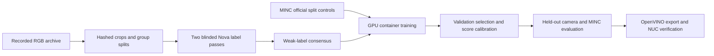

# Plan: train a material student from recorded captures

The objective is to improve material identification on the NUC using existing
camera evidence and Nova 2 Lite as a weak labeler. Train and export on the
GPU desktop in containers, evaluate recognition and abstention, and provide
a checked OpenVINO artifact for the local runner.

The companion [repeatable process](material-distillation-process.md) gives
the commands and artifact layout. The
[training results](material-distillation-results.md) record the actual run.

## Data and labeling

The first run starts from the existing observation archive: 144 recorded
RGB frames across three capture sessions, with 966 saved detector boxes.
These are the retained camera observations, rather than a continuous video
file. The original archive is opened read-only.

Export eligible crops with image hashes and their original frame, observation,
session, bounds and track identities. Exact pixels are deduplicated.
When identical pixels recur across sessions, retain the occurrence from
the later held-out split and preserve all source occurrences.
Approximate visual groups combine matching tracks and similar perceptual
hashes, aspect ratios and mean colors. Reserve groups visible in later
sessions for validation or test; do not put their earlier views into training.
Use at most two representative views per group.

The first snapshot selects 192 crops from 154 approximate groups: 134 train,
29 validation and 29 test. These groups are not verified physical-object
identities. An additional frozen-feature similarity filter removes training
camera crops with cosine similarity ≥0.985 to held-out camera crops.

Nova receives actual scene/crop images, with sample numbers and no detector
labels, student predictions or prior reviews. Each crop receives two separate
calls with the same inputs. These are repeatability checks of one model, not
independent human annotations.

Label the dominant *visible material appearance*, with supporting cues.
Skin and food are explicit rejection labels. Preserve mixed and uncertain
cases without forcing a dominant material. Do not infer hidden composition
or label a whiteboard as paper merely because it has writing.

Use agreed dominant labels only when both passes have at least moderate
confidence. Strong agreement receives loss weight 0.6; moderate agreement
receives 0.3. Uncertain, mixed, disagreeing and missing rows receive no hard
training target. Source/crop identities must be unambiguous; a malformed
individual row does not discard unrelated valid rows.

All request attempts, raw responses, image hashes, prompts and parser versions
remain auditable. Never replay a recorded attempt on resume. An unambiguous
JSON wrapper-format variant may be normalized without changing IDs or labels.
No missing IDs, unsupported labels or material certainty are invented.

## Labeled control

Add a bounded MINC control dataset for ten supported categories. Use official
split 1: 100 train, 20 validation and 20 test images per category, totaling
1,400 images. Exclude all 200 images from the earlier pilot from every new
split. These annotated categories receive loss weight 1.0.

This provides a labeled material comparison separate from the VLM's weak
camera references, and prevents an apparent improvement caused solely by
imitating the labeler. It remains a texture/material benchmark rather than
human-verified camera deployment accuracy.

## Training experiments

Use `google/siglip2-base-patch16-384`, pinned to revision
`f775b65a79762255128c981547af89addcfe0f88`. It is a SigLIP2-family checkpoint
whose actual Transformers model type is `siglip`. Train its existing
`AutoModel.vision_model` and normalized pooled features. Do not substitute
the NaFlex `Siglip2ForImageClassification` implementation for this checkpoint.

Both experiments share preprocessing, labels, splits and feature provenance:

1. Train a supervised linear material head on frozen image features.
2. Start from the selected head and update the last two vision blocks, final
   normalization and attention-pooling head, alongside the material head.

Use class-frequency-adjusted weighted cross-entropy. Material appearance is
the first single-dominant-label target; retain mixed-material annotations
for a later multi-label experiment. This run does not silently treat mixed
objects as single-material ground truth.

The desktop has an NVIDIA A10G with approximately 23 GB GPU memory and Docker
with an NVIDIA runtime. Pin the training base image by digest. Transfer
pixels and annotations over SSH; Bedrock labeling uses the NUC's existing
`default` AWS profile. Training containers publish no ports, run as the
user, read the dataset through a read-only mount, and use bounded CPU/memory.
After prefetching weights/features, training can run without network access.

## Evaluation and decision rules

Select checkpoints using validation only. The objective uses public validation
agreement and, when at least ten material references are available, camera
teacher agreement. The final test set is evaluated after selection.

Fit a score temperature and acceptance threshold on validation. Seek maximum
reference coverage with at least 85% agreement in each evaluable domain.
Score calibration against a teacher is not calibrated real-world material
probability. Classes with fewer than three training examples, rejection
classes and unqualified heads remain unavailable as accepted materials.

Report separately:

- Public MINC category accuracy and accepted-label precision/coverage.
- Camera agreement with the weak teacher, accepted-reference agreement and
  coverage.
- Unreferenced acceptance on mixed/uncertain camera examples.
- Rejection of skin/food and support for sparse classes.
- The unchanged zero-shot encoder on the identical held-out inputs.
- Numerical export parity and inference results on the NUC.

Choose the candidate from validation results, not by repeatedly optimizing
the test set. Prefer no identification to unsupported certainty. A model
that only improves training fit or teacher agreement cannot be called
deployment-qualified material accuracy.

## Export and local integration

Export the normalized vision encoder to FP32 OpenVINO and package the learned
linear head as a checked NumPy artifact. Preserve preprocessing, source
revision, label mapping, training-data hashes, thresholds, loss weights,
changed-encoder evidence and export-parity results in the manifest.

Compare source CPU and exported embeddings on real inputs and require maximum
absolute error ≤1e-4. Replay the candidate with `MaterialClassifier` on the
NUC and compare its scores/decisions against container evaluation.

The runtime supports the trained head as an optional artifact. Its own score
and calibration policy are separate from the old cosine-similarity policy.
A user can select the artifact with the runner's material-model directory
option (`--materials-model-dir`). Keep the unchanged model as a reproducible baseline.

## What the first exercise can establish

It can establish a working VLM-to-student training process, held-out category
results, camera teacher agreement, rejection behavior, numerical export
parity and NUC compatibility.

The recordings mostly show one office and repeated objects. Approximate
grouping cannot guarantee physical-object disjointness. The exercise cannot
establish performance in new rooms, unseen physical objects, IR/depth material
recognition or verified chemical composition. Further capture sessions and
human-checked material references are the next qualification step.

## Verifiable claims

| Claim | Evidence or acceptance check |
|---|---|
| Training uses retained camera pixels without changing the archive | Read-only SQLite access; source and crop hashes in `dataset.json` |
| Neither detector nor student predictions label the training crops | Teacher prompt tests and retained image/request receipts |
| Two-pass uncertainty never becomes a forced material target | Consensus tests, per-row status and zero loss weights |
| Evaluation reserves later-session appearance groups | Split tests, group assignments and recorded feature-similarity exclusions |
| Exact deduplication cannot hide a later held-out occurrence | End-to-end archived-frame duplicate regression |
| The public comparison uses disjoint official splits | `controls.json`, official split lists and excluded pilot IDs |
| Both training variants update the intended parameters | Learned head files; changed encoder tensor count is zero for frozen and positive for fine-tuned |
| Selection and acceptance thresholds use validation only | Training/calibration code, validation-selection regression and saved history |
| Camera agreement is reported separately from annotated category accuracy | `results.json` and NUC replay cohort denominators |
| Export preserves numerical behavior | Nine-input source/export embedding gate at maximum absolute error ≤1e-4 |
| The artifact works in the NUC application's runtime | Full held-out test replay with matching top candidates, acceptance decisions and score error ≤1e-4 |
| Sparse classes and unqualified heads cannot become accepted materials | Runtime support/qualification tests and replay decisions |
| The console preserves score semantics | Browser tests for legacy similarity and learned appearance scores |
